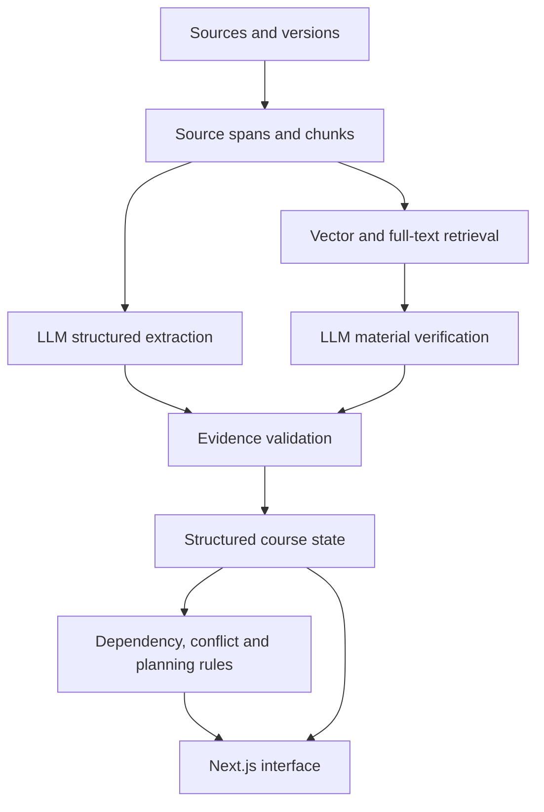

# CourseFlow

**Document intelligence for course requirements, deadlines and obligations — with versioned source evidence behind the results.**

CourseFlow turns assignment briefs, handbooks, slides and announcements into structured requirements and a cross-course study plan. Users can inspect the supporting excerpt, see conflicting deadlines, and track what changes when a source is updated.

**Python · FastAPI · PostgreSQL / pgvector · NVIDIA Nemotron · Next.js · Docker**

[Run the demo](#run-the-demo) · [Architecture](#architecture) · [Evaluation](#evaluation) · [Code walkthrough](#code-walkthrough) · [Limitations](#limitations-and-next-steps)

<!-- Add your recording at this path. Use a caption that accurately describes the recorded mode; never label replay as live inference. -->


*The default demo uses synthetic course documents and recorded model outputs. Replay passes through the application’s evidence gates and deterministic rules; it does not demonstrate fresh inference on an arbitrary uploaded PDF.*

## What it does

A deadline can disagree across documents. A handbook can contain a mandatory review that an assignment brief omits. A revised announcement can invalidate a previously correct plan.

CourseFlow makes those relationships inspectable:

| Capability | Result |
|---|---|
| Structured extraction | Assessments, deadlines, requirements and obligations linked to source evidence |
| Material discovery | Requirements mapped to retrieved teaching material, with source locations |
| Evidence inspection | Stored excerpts with document version and page, slide or section |
| Conflict detection | Disagreeing deadlines shown together rather than silently resolved |
| Change propagation | A simulated LMS sync updates affected intelligence and the study plan |
| Study planning | Cross-course next steps with dependencies and a reason for their order |

## Project status

This is a working prototype, not a production LMS integration.

| Area | Current implementation |
|---|---|
| Reproducible demo | Two fictional Northbridge University courses; recorded model outputs and embeddings |
| Live inference | Evaluation runners and an optional **Analyze live with Nemotron** action for one demo assessment; credentials required |
| Document ingestion | Backend import path; see the [development guide](docs/development.md#importing-a-document). This is separate from an end-to-end upload UI |
| LMS connector | Synthetic `DemoConnector`; no live Moodle connection |
| Access | One demo learner; no authentication or user-level authorization |
| Deployment | Docker demo stack; no public hosted URL included |

## Architecture

A modular monolith keeps document provenance, application state, vector search and full-text search in one PostgreSQL-backed system.



Retrieval supports **requirement-to-material mapping**. CourseFlow presents structured state and evidence rather than a conversational question-answering interface.

| Component | Responsibility |
|---|---|
| FastAPI, async SQLAlchemy, Pydantic, Alembic | API, validated contracts, persistence and migrations |
| PostgreSQL + pgvector | Relational state, embeddings and full-text search |
| NVIDIA Nemotron through Nebius Token Factory | Structured extraction and material verification |
| Qwen3-Embedding-8B | Document and query embeddings |
| Next.js, React, TypeScript | Requirements, source evidence, conflicts and study-plan views |

### Model output and application decisions

| LLM responsibilities | Deterministic application responsibilities |
|---|---|
| Propose assessments, requirements and obligations | Validate schemas, evidence references and supported values |
| Select relevant material from retrieved candidates | Reject invented candidate IDs and invalid evidence |
| Return structured model output | Compute dependencies, conflicts, supersession and the plan |

The orchestration is a fixed, traced workflow, not an autonomous tool-using agent loop. Each course has a `WorkflowRun`; failed steps stop processing and record an error category. Source changes scope reprocessing to affected versions.

[System context](docs/architecture/system-context.md) · [Data contract](docs/architecture/data-contract.md) · [Workflow implementation](backend/app/orchestration/workflow.py)

## Evaluation

Results below come from committed reports on frozen **synthetic** datasets. They measure specific tasks, not overall product accuracy or performance on real university documents.

### Retrieval comparison

The retrieval/v1 benchmark contains **12 positive queries and 2 invariant-only probes**, covering keyword, paraphrase and mixed queries, stale versions and cross-course results. It replays recorded embeddings through the application search service; the scored runs make no live provider calls.

| Mode | Recall@1 | Recall@3 | Recall@5 | MRR@10 |
|---|---:|---:|---:|---:|
| Vector | 9/12 | 11/12 | 12/12 | 0.8403 |
| Full-text | 9/12 | 11/12 | 12/12 | 0.8500 |
| Hybrid / RRF | 9/12 | 12/12 | 12/12 | 0.8611 |

All three modes passed the two invariant probes. A predefined selection rule chose hybrid as the default. Two replay runs returned identical metrics and hit lists.

**Interpretation:** hybrid recovered one additional positive case in the top three on this corpus. This small benchmark was used for default selection; it does not establish statistical significance or independent generalization performance.

[Per-case results](evals/reports/retrieval-v1.md) · [Dataset and reproduction instructions](evals/README.md) · [Selection decision](docs/decisions/ADR-008-hybrid-retrieval-and-evaluation.md)

### Structured extraction

Recorded live Nebius experiments on the frozen Northbridge golden dataset report:

| Task | Reported result | Evidence |
|---|---|---|
| Deadline extraction | Exact match 6/6; zero false verified assessments in the reported run | [Assessment report](evals/reports/assessment-extraction-v2-fast-thinking-off-gate-v3-golden-v2.md) |
| Requirement extraction | Verified labelled recall 11/11 | [Claims report](evals/reports/claim-extraction-v1-fast-thinking-off-gate-v3-golden-v2.md) |
| Obligation extraction | Verified labelled recall 2/3; one labelled obligation missed | [Claims report](evals/reports/claim-extraction-v1-fast-thinking-off-gate-v3-golden-v2.md) |

Requirement and obligation labels are incomplete, so these reports do **not** establish precision or F1. Extraction experiments use live model calls; offline demo replay and retrieval replay are different execution modes. Reports include the model, prompt/gate versions and usage details.

## Engineering decisions

### Hybrid search with rank fusion

Vector similarity captures semantic matches; PostgreSQL full-text search complements it for exact terminology. Reciprocal Rank Fusion combines their **ranks**, avoiding direct addition of incompatible raw scores. Search scores are ranking signals, not probabilities of correctness.

Search is scoped to current resource versions within a course and a compatible embedding space. The vector path uses **exact cosine search**, with no ANN/HNSW index. Course scoping is a data boundary, not user authorization.

### Structure-aware, provenance-preserving chunks

The `span-pack/v1` chunker preserves source offsets, keeps consecutive slide text and notes together, and attaches headings to following content. Oversized spans are split at preferred text boundaries.

Its target is 800 **estimated** tokens, with a hard maximum of 1,000 and overlap up to 120. The estimate is `ceil(characters / 4)`, not a tokenizer measurement. These are versioned prototype settings, not universal optimal values.

### Evidence checked outside the model

Evidence links resolve through stored source spans and resource versions. The application checks citation location and applicable value constraints rather than treating model confidence as verification.

Quote presence is not a general semantic entailment test: an authentic quote can still be misinterpreted. Model quality, validation coverage and human review remain relevant.

### Conflicts preserved and decisions versioned

Conflicting deadlines remain visible with their sources. The planner uses the earlier date conservatively and does not present that choice as resolution of the conflict. Dependencies, conflict handling, supersession and planning use versioned deterministic rules.

[Retrieval design](docs/architecture/retrieval.md) · [Ingestion design](docs/architecture/ingestion.md) · [Architecture decisions](docs/decisions/)

## Evidence validation and failure handling

| Condition | Handling |
|---|---|
| Unknown evidence reference or missing quote | Reject the unsupported result |
| Multiple matching quote locations | Treat the evidence as ambiguous rather than choosing silently |
| Permissive wording or unsupported obligation category | Route affected claims to `needs_review` |
| Invented material candidate ID | Reject through the candidate subset gate |
| Inconsistent retrieval index | Refuse search rather than return a partial, inconsistent corpus |
| Workflow step failure | Stop the workflow and retain the recorded failure category |

Source text is passed as delimited data, with per-call nonces and no model tools in the extraction flow. The committed injection example and control are useful regression checks, **not proof of general prompt-injection immunity**.

The application does not submit coursework or write to an LMS. Demo reset and sync controls do modify local demo state.

## Run the demo

Prerequisite: Docker with Compose v2. Run from a fresh clone:

```bash
git clone https://github.com/eseeyuh/courseflow.git
cd courseflow
docker compose -f infra/demo/compose.yml up -d --build --wait
```

Open **http://localhost:3000**. Startup migrates the database and initializes the synthetic demo state. The first build requires network access to fetch dependencies; the default model replay needs no API key or live inference calls.

Try the [three-minute walkthrough](docs/demo/demo-script.md): inspect a requirement and its evidence, compare conflicting deadlines, then trigger the simulated sync and inspect the changes.

Stop the stack:

```bash
docker compose -f infra/demo/compose.yml down
```

**Optional live analysis:** set `NEBIUS_API_KEY`, `NEBIUS_BASE_URL`, `MODEL_FAST` and `MODEL_STRONG` in your local root `.env`, then start with:

```bash
docker compose --env-file .env -f infra/demo/compose.yml up -d --build --wait
```

Use **Analyze live with Nemotron** on Applied Machine Learning’s Coursework 1. This makes a provider call and incurs usage charges; it is not a complete live LMS workflow. Keep credentials out of git.

Demo controls are unauthenticated. Keep the stack local unless you deliberately provide an appropriate deployment boundary. Configuration: [development](docs/development.md) and [demo environment template](infra/demo/.env.example).

## Development and checks

The [development guide](docs/development.md) covers Python/uv and Node prerequisites, document import, migrations, API docs and troubleshooting. With dependencies installed and the test database available:

```bash
docker compose up -d db
cd backend
uv sync --locked
uv run pytest
uv run ruff check .
uv run ruff format --check .
```

From `frontend/`:

```bash
npm ci
npm run lint
npm run typecheck
npm run build
```

Backend provider tests use scripted responses, not real model calls. With the development app running, `npx playwright test` exercises the demo golden path. Test outcomes are distinct from live-model evaluation; this README does not imply a fresh test run on every checkout.

## Code walkthrough

| Start here | What to inspect |
|---|---|
| [Ingestion](backend/app/ingestion/service.py) | Source import and versioning |
| [Chunking](backend/app/retrieval/chunking.py) | Structural boundaries, size estimates and offsets |
| [Search](backend/app/retrieval/search.py) | Course/version scope, index verification and search modes |
| [Rank fusion](backend/app/retrieval/fusion.py) | Deterministic RRF and tie-breaking |
| [Claim evidence location](backend/app/extraction/claim_gate.py) | Quote matching and original source offsets |
| [Workflow](backend/app/orchestration/workflow.py) | Fixed steps, traces and failure propagation |
| [Evaluation](evals/README.md) | Frozen datasets, replay, metrics and reproduction |

## Limitations and next steps

- **Synthetic data and simulated LMS:** no validated real-university deployment or live Moodle connector.
- **Replay-first demo:** arbitrary new documents do not have a complete live upload-to-result UI.
- **No authentication:** course-scoped retrieval does not provide multi-user access control.
- **Small evaluations:** incomplete extraction labels and no broad generalization claim.
- **Material mapping is broad:** several slides can be selected; stored mapping ranks do not reliably distinguish the best slide.
- **Incomplete recall:** one of three labelled obligations was missed in the reported extraction run.
- **Desktop-first interface:** mobile presentation is not tuned.

Next priorities are a complete live document-processing path, independent evaluation on additional documents, and server-enforced access control. These are planned improvements, not current capabilities. Detailed gaps: [post-hackathon accuracy work](docs/POST_HACKATHON_ACCURACY.md).

## Project background and contributing

Developed for the Nebius × NVIDIA Global AI Hackathon, *Best Apps & Agents*. Repository owner: [eseeyuh](https://github.com/eseeyuh). See [contributors](https://github.com/eseeyuh/courseflow/graphs/contributors) and commit history for recorded contributions.

[Contributing](CONTRIBUTING.md) · [Security](SECURITY.md) · [Technical facts](docs/demo/technical-facts.md)

## License

[Mozilla Public License 2.0](LICENSE).
