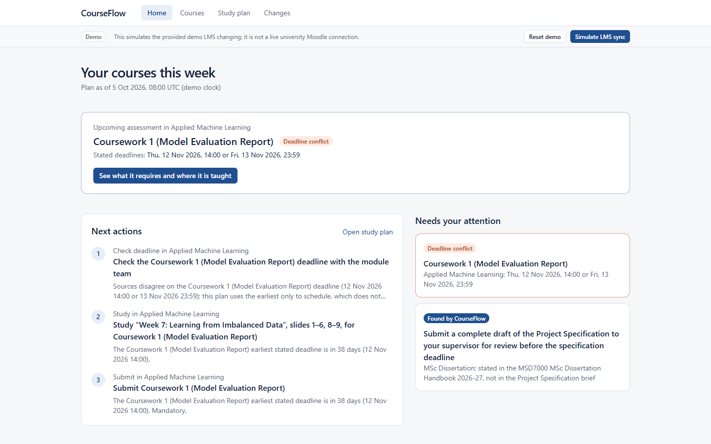
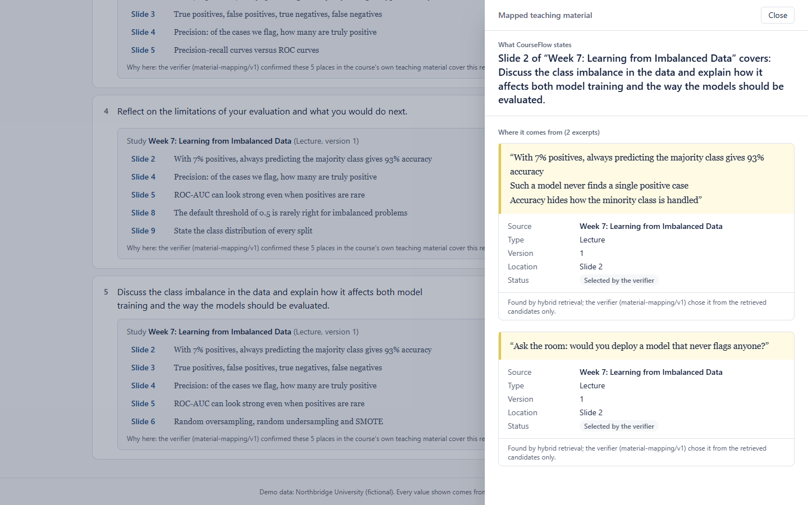
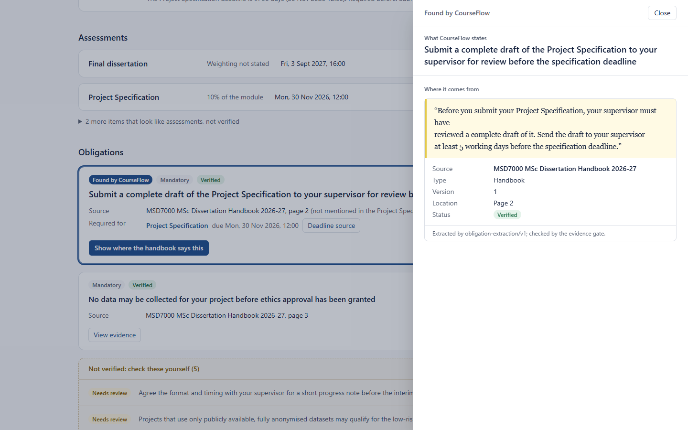
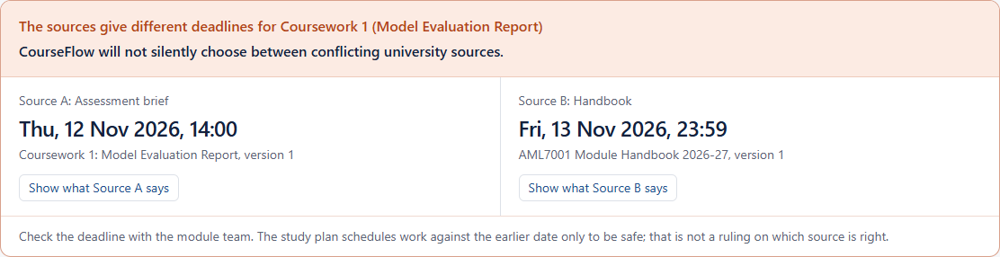
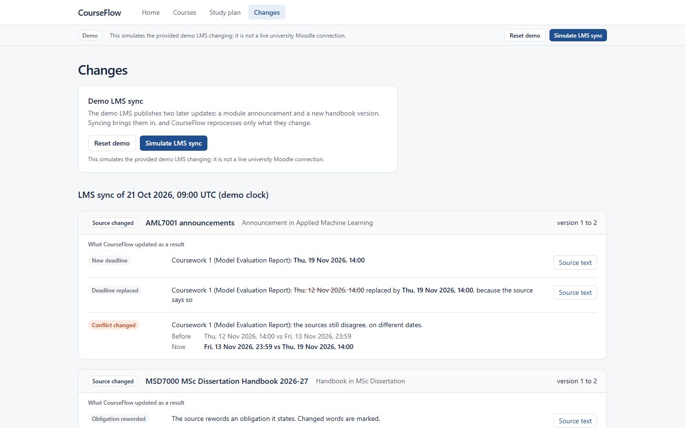
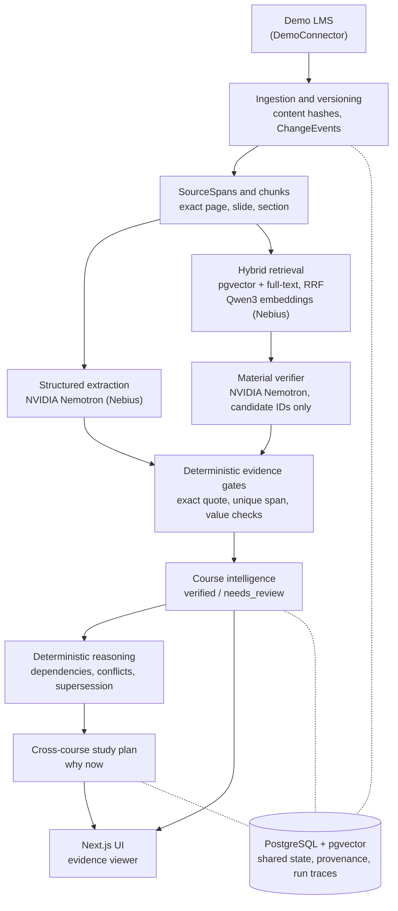

# CourseFlow

**CourseFlow turns a student's scattered LMS content into evidence-backed next steps: what is due, what it requires, where exactly to study for it, and how the system knows.**

Built for the Nebius × NVIDIA Global AI Hackathon (*Best Apps & Agents*). Open source under [MPL-2.0](LICENSE).



## The problem

A course lives in many places: the assignment brief, the module handbook, lecture slides, announcements, workshop sheets. The information a student needs is spread across them, and it does not always agree.

- A deadline appears in the brief and again, differently, in the handbook.
- A requirement says "discuss class imbalance" but not which lecture teaches it.
- A handbook quietly requires a supervisor to review your draft before you may submit, and the brief never mentions it.
- An announcement moves a deadline, and nothing tells you which of your plans just changed.

Moodle stores the information. Nothing reconstructs the path through it.

## What CourseFlow does

```text
LMS resources (briefs, handbooks, slides, announcements)
  → versioned sources with exact page / slide / section locations
  → evidence-backed course intelligence: assessments, deadlines, requirements, obligations
  → each requirement mapped to the exact teaching material
  → dependencies, source conflicts and changes detected
  → one cross-course study plan, with a reason for every step
```

Every claim on screen opens the exact sentence it came from.

## Key demo features

| Feature | What you see |
|---|---|
| **Hidden obligation discovery** | "Found by CourseFlow": the dissertation handbook (page 2) requires a supervisor review of your draft before the Project Specification. The brief never says so. |
| **Assessment requirement extraction** | Coursework 1's five requirements, quoted from the brief, each verified against it. |
| **Requirement → exact learning material** | The class imbalance requirement maps to *Week 7: Learning from Imbalanced Data*, Slide 2: "With 7% positives, always predicting the majority class gives 93% accuracy". |
| **Evidence viewer** | What CourseFlow states, then the exact excerpt with source, version, slide/page/section and verification status. |
| **Dependency reconstruction** | Supervisor review, required for, Project Specification. Ethics approval, required for, Data collection. |
| **Source conflict detection** | Brief: Thu 12 Nov 14:00. Handbook: Fri 13 Nov 23:59. Both shown, each with its source. |
| **Cross-course study plan** | Ordered across both courses with a "why now" per task; mark material *Studied* and the plan is recomputed. |
| **LMS change propagation** | A simulated LMS sync brings in an announcement and a new handbook version: a new deadline, a replaced one, a changed conflict, a reworded obligation, and the study plan updated. |
| **Offline, reproducible demo** | The demo rebuilds from committed model recordings: no API key, no network, no spend, identical every time. |

<table>
<tr>
<td></td>
<td></td>
</tr>
<tr>
<td></td>
<td></td>
</tr>
</table>

More screens: [Coursework 1 requirements](docs/assets/screenshots/02-assessment-requirements.png), [study plan](docs/assets/screenshots/06-study-plan.png).

For reviewers: the [judge summary](docs/demo/judge-summary.md), the [technical facts](docs/demo/technical-facts.md) and the [three-minute demo script](docs/demo/demo-script.md).

## Why it is different

- **Not Moodle plus a chatbot.** There is no chat box. CourseFlow builds structured state (assessments, obligations, dependencies, conflicts, a plan) and shows it.
- **Not summarisation.** It points to the university's original material (this slide, this page) instead of rewriting it.
- **Source-grounded claims.** A claim is *verified* only when deterministic code finds its exact quote in a stored source span and the quote supports the value. Model confidence never verifies anything.
- **No silent conflict resolution.** When sources disagree, CourseFlow shows both and says so. The plan schedules against the earlier date to be safe, and says that is not a ruling.
- **State that follows the sources.** When a source changes, only what it affects is reprocessed: claims are superseded or reworded, conflicts recomputed, and the plan diffed.

## Architecture

A modular monolith: Next.js frontend, FastAPI backend, PostgreSQL + pgvector, and a traced multi-step workflow (`course-intelligence/v1`) whose model steps use NVIDIA Nemotron through Nebius Token Factory.



- **Workflow.** `ingest → assessments → claims → mapping → dependencies → conflicts → validation → plan`, one traced `WorkflowRun` per course with per-step status and counts. A failed step stops the run with a recorded error category; a sync reprocesses only changed versions.
- **Models** (details: [docs/demo/nvidia-nebius.md](docs/demo/nvidia-nebius.md)):
  - `nvidia/Nemotron-3_5-Lightning`, the `MODEL_FAST` role with thinking off, extracts assessments, deadlines, requirements and obligations, and verifies material mappings.
  - `Qwen/Qwen3-Embedding-8B` embeds chunks for retrieval.
  - Both are served through Nebius Token Factory.
- **Rules, not prompts, for consequences.** Dependencies (`dependency-rules/v1`), conflicts (`conflict-rules/v1`), deadline supersession (`source-supersession/v1`) and the plan (`study-plan/v1`) are deterministic and versioned.

Deeper reading: [system context](docs/architecture/system-context.md), [data contract](docs/architecture/data-contract.md), [ingestion](docs/architecture/ingestion.md), [retrieval](docs/architecture/retrieval.md), and the [architecture decisions](docs/decisions/).

## Trust and safety

- **Provenance chain.** Every claim links to an `EvidenceLink`, then a `SourceSpan` with exact character offsets, then a `ResourceVersion`, then a `Resource` and its `Course`. Citations are never generated: the UI shows only stored quotes and locations.
- **Exact evidence.** A quote must occur exactly and uniquely in the cited span, from the same course and version, or the claim is rejected.
- **Verified vs needs_review.** Permissive wording, unsupported categories or conflicting facts become `needs_review`, shown apart and never presented as fact.
- **Prompt injection.** Course text goes to the model only as delimited data in the user turn, with a per-call random nonce; no tools are sent. The Northbridge data contains an injection attempt, and it is never extracted.
- **Constrained outputs.** Models answer in strict JSON schemas and may cite only local span or candidate IDs issued for that call. Anything else is rejected.
- **Conflicts keep both values.** Disagreeing sources produce two deadline rows and a `Conflict`. Only a newer source that says it replaces a date retires one.
- **Read-only.** CourseFlow never submits work or writes to an LMS.

## Run the demo

The demo uses the synthetic **Northbridge University**: two courses, *Applied Machine Learning* and *MSc Dissertation*. It is all invented, with no real course material or student data. It runs offline from committed recordings.

**Deployment status:** the repository contains a one-command Docker demo stack, verified end to end with the golden-path test. A public hosted URL is not currently included; the same command runs it on any Docker host (see *Hosting it* below).

**With Docker only** (one command; the first build takes a few minutes):

```bash
docker compose -f infra/demo/compose.yml up -d --build --wait
```

Open http://localhost:3000. The stack migrates its database and resets to the initial Northbridge state on start. Stop it with `docker compose -f infra/demo/compose.yml down` (add `-v` to delete its data).

**For development** (hot reload; needs Docker, [uv](https://docs.astral.sh/uv/) and Node.js ≥ 20.9):

```bash
cp .env.example .env && cp frontend/.env.example frontend/.env.local
docker compose up -d db                       # PostgreSQL + pgvector
sh scripts/demo-api.sh                        # API on :8000: creates and migrates its own demo database
cd frontend && npm ci && npm run dev          # UI on :3000 (second terminal)
```

Then click **Reset demo** in the Demo strip, and follow the [three-minute demo script](docs/demo/demo-script.md) or the [manual checklist](docs/demo/manual-checklist.md).

**Golden-path test** (with the development setup running; uses your installed Chrome):

```bash
cd frontend && npx playwright test            # reset, every demo step, sync, reset again
```

**Hosting it.** On a server, set the public addresses in `infra/demo/.env` (template: [infra/demo/.env.example](infra/demo/.env.example)) and run the same command behind HTTPS. Set `BIND_ADDRESS`, `WEB_ORIGIN` (the URL people open: the API's only CORS origin), `API_PUBLIC_URL` (compiled into the web image) and `DEMO_DB_PASSWORD`. The API runs with `APP_ENV=demo`. The demo endpoints (reset, simulated sync) are refused only under `APP_ENV=production`, and they are unauthenticated: anyone with the URL can reset the demo.

## Local development

The full development stack (Compose API, document import, retrieval CLI, migrations, tests and troubleshooting) is in [docs/development.md](docs/development.md). The essentials:

```bash
(cd backend && uv sync --locked && uv run pytest)            # needs `docker compose up -d db`
(cd backend && uv run ruff check . && uv run ruff format --check .)
(cd frontend && npm run lint && npm run typecheck && npm run build)
```

## Evaluation

Measured on the frozen synthetic golden dataset with real Nebius calls under spend caps. Reports are in [evals/reports/](evals/reports/); how to rerun them is in [evals/README.md](evals/README.md).

| What | Result |
|---|---|
| Deadline exact match (course, version, local time, timezone) | 6/6, 0 false verified assessments |
| Requirement extraction, labelled recall (verified) | 11/11 |
| Obligation extraction, labelled recall (verified) | 2/3. Supervisor-review case verified, linked and located; the injection attempt never extracted |
| Retrieval, hybrid (12 cases) | Recall@3 12/12, MRR@10 31/36 |
| Material mapping demo acceptance | class imbalance → Lecture 07: pass; irrelevant lecture rejected; no-material case unmapped |

The labels are not exhaustive, so only labelled recall is reported, not precision. The datasets are small; no statistical significance is claimed.

## Current prototype limitations

- **Simulated LMS.** The demo reads a synthetic LMS through a `DemoConnector`. There is no live Moodle connector, and no links to original LMS pages.
- **Replayed intelligence in the demo.** The judge demo replays recorded Nemotron outputs through the same gates. New content needs an API key and the evaluation runners.
- **One demo learner.** There is no authentication, and the demo controls are open to anyone with the URL.
- **Broad material mapping.** A requirement can list several slides of the right lecture, and stored ranks do not separate them.
- **Incomplete obligation recall.** One labelled obligation was missed, and the labels are incomplete.
- **Desktop-first UI.**

More in [docs/POST_HACKATHON_ACCURACY.md](docs/POST_HACKATHON_ACCURACY.md) and [docs/SCOPE.md](docs/SCOPE.md).

## Contributing, security, licence

[CONTRIBUTING.md](CONTRIBUTING.md) · [SECURITY.md](SECURITY.md) · [Mozilla Public License 2.0](LICENSE) ([why](docs/decisions/ADR-003-mpl-2.0-licence.md))
